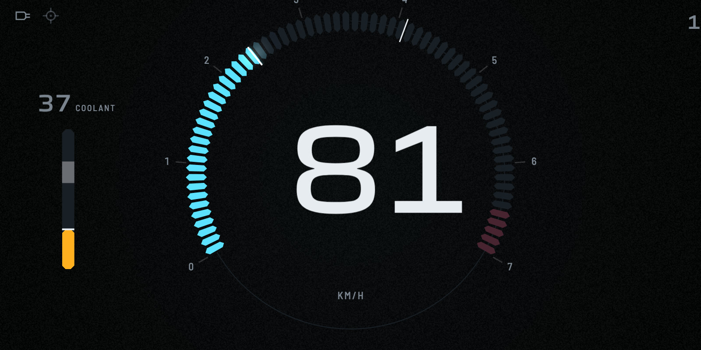
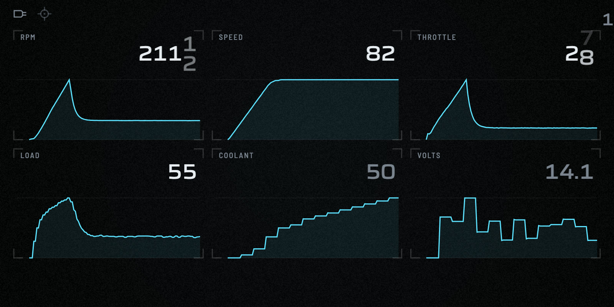
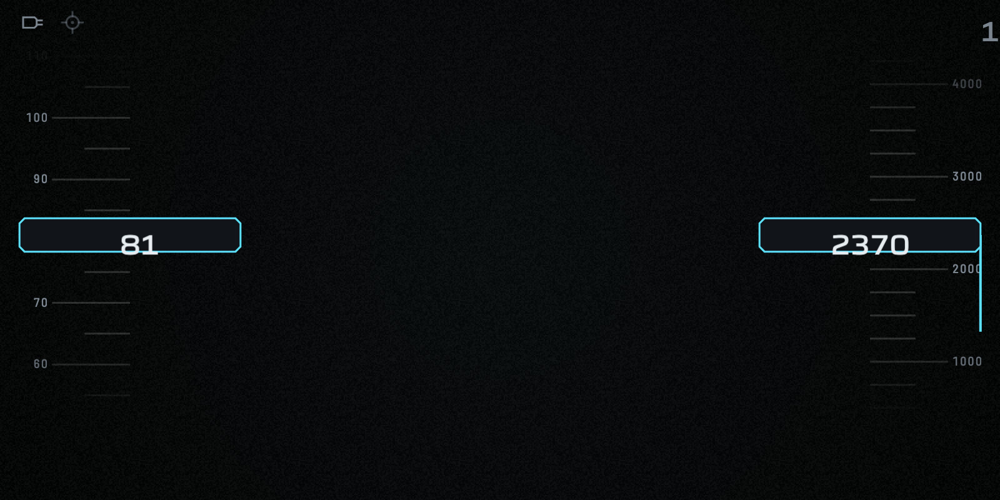
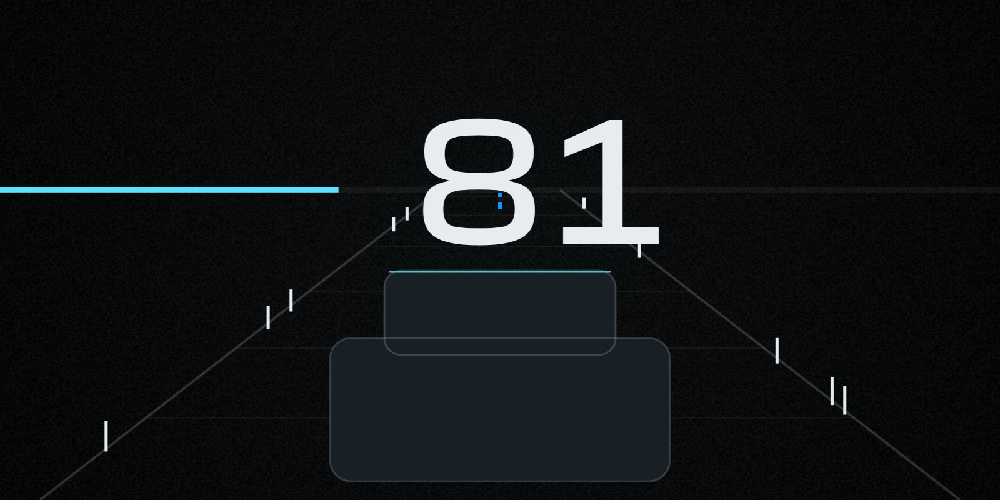

# TapeDash

**An old Android phone, a cheap OBD adapter and a roll of double-sided tape: a car dashboard, a windshield HUD, and a trip computer that shows where the money goes.**

TapeDash is a free, open-source, strictly offline Flutter app. It reads your car through a cheap ELM327 OBD-II adapter and draws what it reads like the best instrument clusters, not like an app.

<p align="center">
  
  
</p>
<p align="center">
  
  
</p>
<p align="center"><sub>Frames from the built-in simulator, captured from the real app. Mid-roll numerals are intentional: they move like an odometer, not like a text field.</sub></p>

## What it does

- **A dashboard built like an instrument.** Five Drive layouts (Apex, Tape, Minimal, Telemetry, Road), four liveries, automatic Daylight and Night modes, numerals that roll with a detent, needles that never jitter, and a startup sequence. The full spec is [DESIGN.md](DESIGN.md).
- **A windshield HUD.** Mirrored, pure black, one colour, huge numerals, with an alignment pattern for setting it up on a reflector film or a 3D-printed holder.
- **A trip computer for your wallet.** ₹ per trip, ₹ per km, km/L, and what idling cost you, with every rupee sorted into exactly one bucket (idling, hard acceleration, high speed, normal driving).
- **A gentle driving coach.** It never speaks while you drive. Tips appear only when the car is stopped or the trip is over, and they are factual, never shaming.
- **Trips, fill-ups and fuel calibration.** Log a fill-up and the fuel estimate calibrates itself against the real litres. Numbers are labelled as estimates, with confidence shown.
- **Fault codes.** Read, look up and (when stopped) clear stored and pending codes.
- **Engine sound (optional).** A synthesised engine note that says only what the tach says. Off by default.
- **Demo Mode.** A built-in simulated car, so you can try everything without a car or an adapter.

## Principles

- **Strictly offline.** No cloud, accounts, analytics, crash reporting, ads or price lookups. Fuel prices are entered by you. The only network use is a local WiFi ELM327 adapter, and the app refuses any address outside private ranges. `tool/check_offline.sh` enforces this on every commit.
- **Old phones first.** Designed to run smoothly on a 2 GB RAM, 32-bit ARM phone with a 720p screen on Android 7.0.
- **Open source and F-Droid compatible.** No Google Play Services, Firebase or proprietary SDKs.
- **Honest numbers.** Fuel and money are estimates. Rupees are rounded to whole numbers, km/L to one decimal.
- **Safe by design.** Nothing on a driving screen needs a touch. Settings, tips, fill-ups and fault-code clearing are reachable only when parked.
- **Simulator first.** Every feature runs end to end against a built-in vehicle simulator, headlessly, in `flutter test`.

## Status

**Pre-alpha, and being driven on a real car.** The app is built and tested on the simulator through phase 6, and the first real drives (a BLE ELM327 on a petrol CVT car) are in. Phase 7, tuning against real recordings, is under way.

| | |
|---|---|
| Built and tested on the simulator | Dashboard, HUD, trips, fuel and money, coach, Review, History, Garage, Diagnostics, onboarding |
| Run on real hardware | A BLE adapter in one car, over two long drives. WiFi and Bluetooth Classic adapters have **not** been tried on a real car yet. |
| Not built yet | Offline map under the route, F-Droid metadata, a signed release. See [docs/STATUS.md](docs/STATUS.md). |

[docs/STATUS.md](docs/STATUS.md) is blunt about what has and has not been verified. If you try TapeDash on your own car, your report is genuinely useful: see [Contributing](#contributing).

There are no release builds yet. For now, build from source.

## Quick start

Android only (Bluetooth Classic ELM327s, the common cheap kind, cannot work on iOS).

You need the **Flutter stable SDK** (CI pins 3.44.1), **JDK 17** and the **Android SDK**. Details are in [docs/DEV_SETUP.md](docs/DEV_SETUP.md).

```sh
git clone https://github.com/ictashik/tapedash.git
cd tapedash
flutter pub get
tool/verify.sh                 # format, analyze, tests and the offline check
```

**Try it without a car.** Run on a phone or emulator and choose **TRY A DEMO DRIVE** on the first screen:

```sh
flutter run
```

**Install on a phone.** For a first look, a debug build is fine. It is much slower than the real app, so judge smoothness on a release build:

```sh
flutter build apk --release --split-per-abi --target-platform android-arm,android-arm64
adb install -r build/app/outputs/flutter-apk/app-arm64-v8a-release.apk    # or app-armeabi-v7a-release.apk for a 32-bit phone
```

**In the car.** Plug the ELM327 into the OBD port, mount the phone, and choose **CONNECT MY CAR**. The step-by-step test script, in order, is [docs/HARDWARE_HANDOFF.md](docs/HARDWARE_HANDOFF.md).

## The simulator

The simulator is a first-class feature, not a test fixture. It is a physical car model (mass, drag, a CVT, warm-up, fuel), a set of scripted drivers, an ELM327 adapter that prints byte-accurate text with injectable quirks, a GPS, and six vehicle profiles. All of it is pure Dart.

```sh
dart run tool/sim_server.dart --list                        # scenarios, profiles, adapter quirks
dart run tool/sim_server.dart --scenario city_stop_go --profile petrol_cvt_map
dart run tool/record_sim.dart --all                         # record all ten scenarios as replayable logs
```

`sim_server` serves the simulator over TCP, so you can point the real WiFi transport at it (`10.0.2.2:35000` from an Android emulator) and exercise the production code path with no hardware. A 30-minute simulated drive runs in seconds on a fake clock, and the tests compare the app's estimates against the simulator's exact ground truth.

## Project layout

```
lib/
  core/        clock, scheduler, units, ₹ formatting (Indian digit grouping)
  sim/         the vehicle simulator (pure Dart)
  obd/         ELM327 layer, PIDs, DTCs, poller, transports (sim, WiFi, BT Classic, BLE, replay)
  vehicle/     derived values and smoothing
  fuel/ money/ fuel-flow estimators, fill-ups, calibration, attribution
  coach/       event detection, sweet spot, tips
  trips/       trip lifecycle and storage
  sound/       the engine sound synth (pure Dart)
  platform/    Dart side of the thin Kotlin channels (GPS, Bluetooth, device, audio)
  ui/          the design system, pages, HUD, Design Lab
android/       the Kotlin channels
test/          unit, e2e simulated drives, widget, design (goldens and design lint)
tool/          check_offline.sh, verify.sh, sim_server, record_sim, sound lab, font subsetting
recordings/    replayable raw ELM327 sessions (simulator-made and from real drives)
docs/          STATUS, DECISIONS, DEV_SETUP, HARDWARE_HANDOFF, design reviews
```

The layering rules (what may import what) are enforced by tests. The full architecture, the OBD and fuel maths, and the roadmap are in [CLAUDE.md](CLAUDE.md).

## Documents

| | |
|---|---|
| [DESIGN.md](DESIGN.md) | The visual, motion and interaction spec. Binding for everything you see. |
| [CLAUDE.md](CLAUDE.md) | Architecture, data, offline guarantees, safety, performance budgets, roadmap. Binding for everything you don't. It is also the project's brief for its AI coding agent. |
| [docs/STATUS.md](docs/STATUS.md) | Where the project is, and what has and has not been verified. |
| [docs/DECISIONS.md](docs/DECISIONS.md) | The choices made, and why. |
| [docs/DEV_SETUP.md](docs/DEV_SETUP.md) | Toolchain, building, emulators and phones. |
| [docs/HARDWARE_HANDOFF.md](docs/HARDWARE_HANDOFF.md) | How to test on a real adapter and car, and what to report back. |
| [recordings/README.md](recordings/README.md) | The session log format and how replay works. |

## Contributing

TapeDash is young and moves fast. Issues and pull requests are welcome; read [CONTRIBUTING.md](CONTRIBUTING.md) first. The most valuable contribution right now is a **real-car report**: your adapter, your car, which PIDs it answered, and a session recording (the app can record one; see [docs/HARDWARE_HANDOFF.md](docs/HARDWARE_HANDOFF.md)).

## Safety

TapeDash is an aid, not a certified instrument. Set it up while parked. It is designed so that nothing needs your attention while you drive, but you remain responsible for driving safely. Fuel and cost figures are estimates. Do not use "Clear fault codes" on a car you do not understand: it also clears the data a mechanic would want.

## License

Apache License 2.0. See [LICENSE](LICENSE). Bundled fonts (Saira, Barlow, Barlow Semi Condensed) are under the SIL Open Font License 1.1.
