# Design review: Google Maps' turns on the HUD (DESIGN.md 8, docs/NAV.md)

Written 2026-10-24. You asked for a simple way to see the next turn, the ETA and the speed on the HUD, with Google Maps doing the routing. This is that layout, how it looks, and what it cannot do. **Nothing here has met a real phone or a windshield**: the frames are renders (the design lint's own test harness) and screenshots from **an Android 16 emulator and an Android 7.0 emulator**, driven by the simulated car, by a stand-in for Maps' notification, and, in two frames, by **real Google Maps 25.33**.

The HUD takes this layout over by itself while Maps is guiding, and gives your chosen layout back when it stops. Each frame comes twice where it matters: **as designed**, and **as the glass shows it** (mirrored, which is what the windshield reflects).

## The layout

| As designed (720 x 360) | As the glass shows it |
|---|---|
| 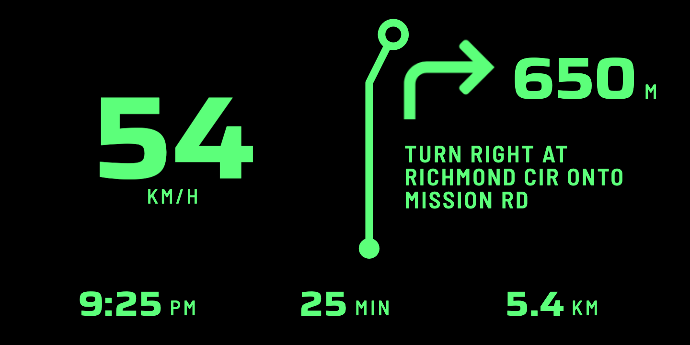 | 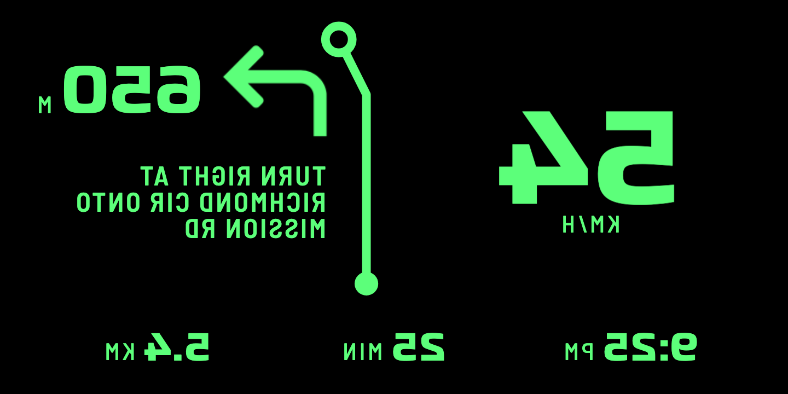 |

The speed on the left, as in Drive + Money. On the right: **Google's own arrow** (a one-colour mask Maps puts in its notification, painted in the HUD colour), **the distance to the turn**, **Google's instruction** (up to three lines, cut at a word), and along the bottom **the ETA, the time left and the distance left**. The bold line is the "line map": it climbs from the car to a ring at the junction, leans the way the arrow turns, and the dot on it climbs as the turn comes up (over the last 500 m, counting down on the car's own speed between Maps' updates; the figure in text is Maps' own, because that is the one its voice agrees with).

**It is not a map.** Google Maps gives no route to other apps, so TapeDash cannot draw the road ahead. The line is a sketch of the next junction and DESIGN.md says so.

## The states

| A turn, nearer | The last metres (Maps drops the distance) | Straight on, no turn in it |
|---|---|---|
| 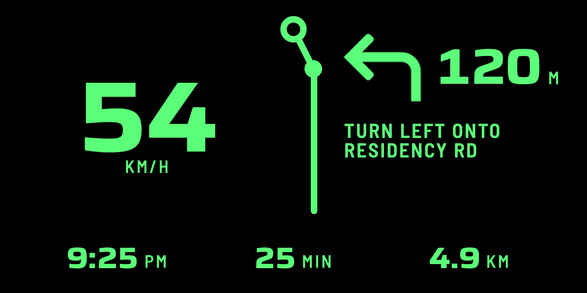 | 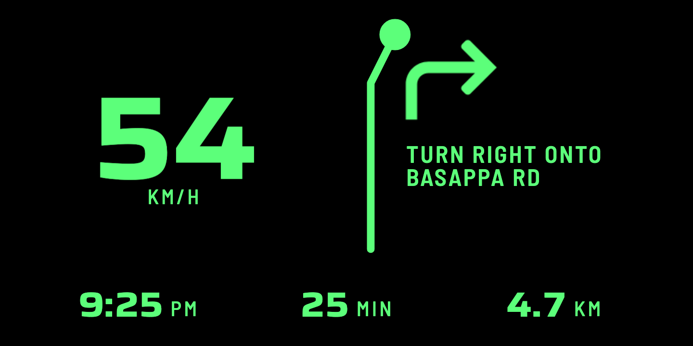 | 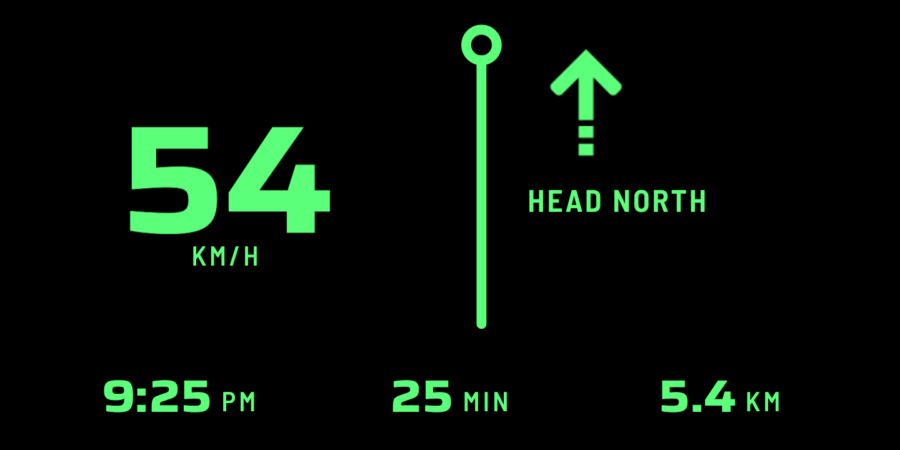 |

| Rerouting (Maps' own words) | Starting | Maps has gone quiet |
|---|---|---|
| 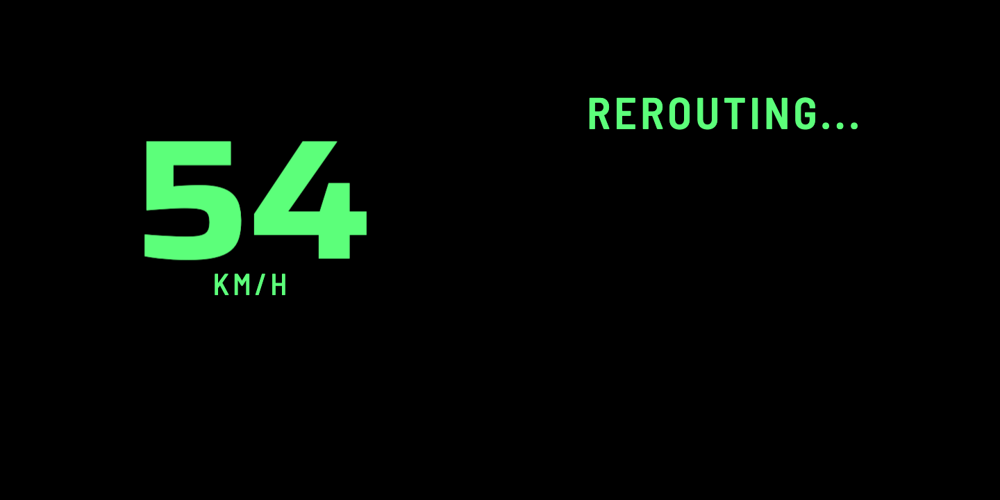 | 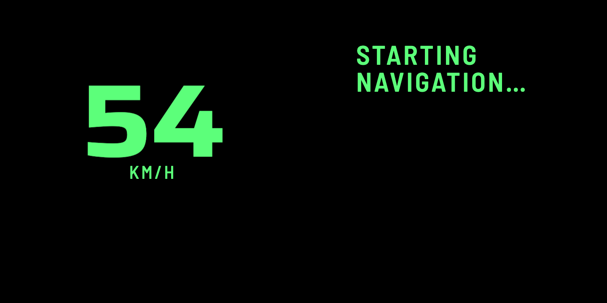 | 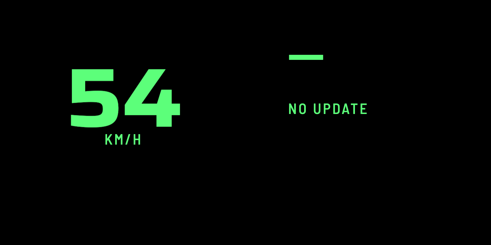 |

- **The last metres:** real Maps counts `80 m`, `70 m`, `50 m` and then says only `Turn right onto Basappa Rd`. The dot then fills the ring: the turn is now.
- **Rerouting and starting** show Google's words and nothing else: no arrow, no line, no figures.
- **Maps gone quiet** (15 s with the car moving, 3 minutes standing): a dash and **NO UPDATE**, and no figures. An old turn is never shown as a live one.

## Other lengths and sizes

| A long instruction (cut at a word) | Miles (when Maps writes in them) | 640 wide, as the glass shows it |
|---|---|---|
| 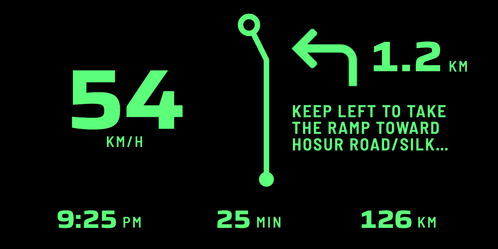 | 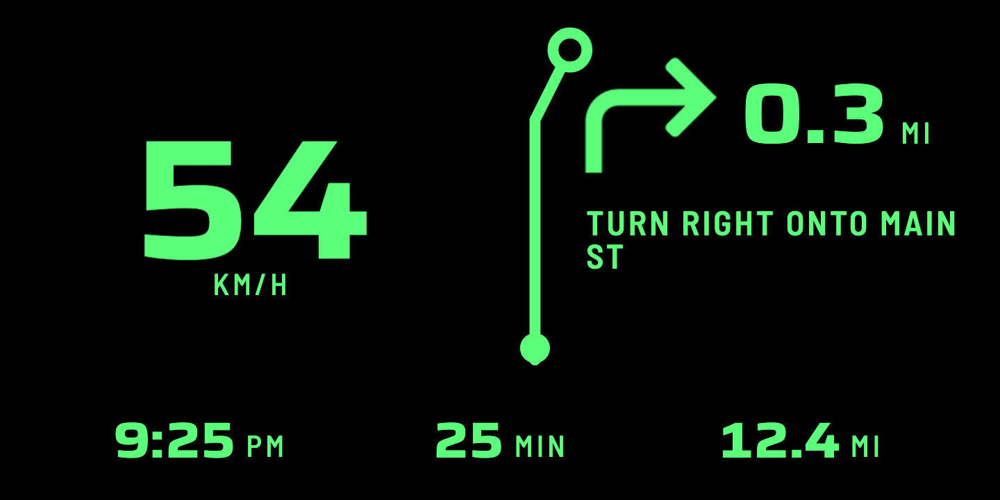 | 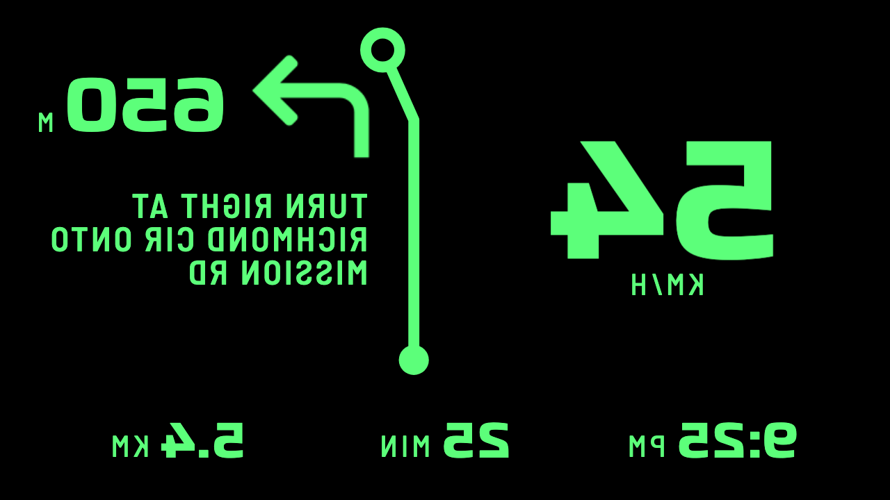 |

The same layout at 800 wide: [render-right-800.png](screenshots/render-right-800.png). Tested at 640, 720 and 800 wide for one colour on pure black, nothing under the 0.06H floor, and strokes of at least 5 lp.

## On the emulators

| Android 16, the simulated car, the stand-in (250 m) | Android 7.0, the same (200 m) |
|---|---|
| 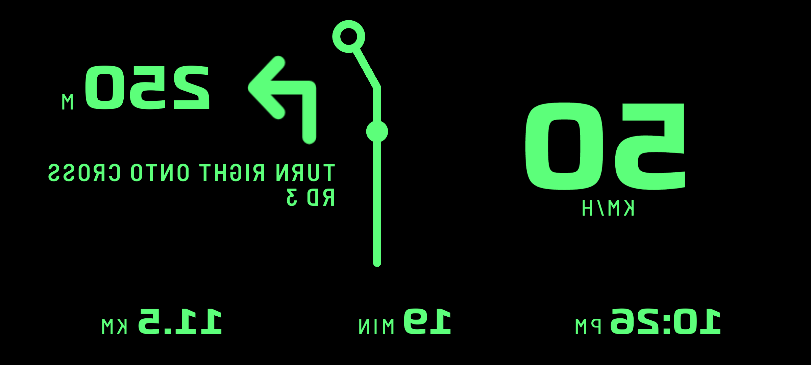 | 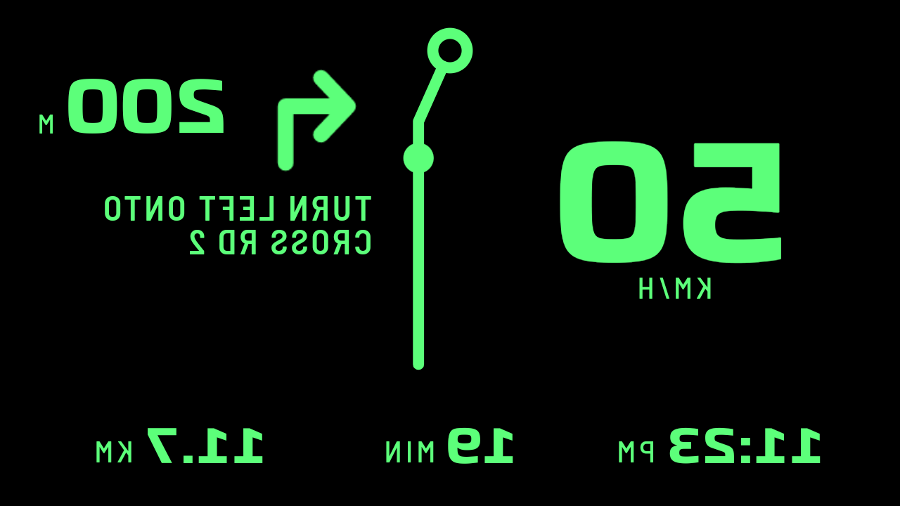 |

| **Real Google Maps 25.33**, 350 m | **Real Google Maps**, 110 m, the car at a signal |
|---|---|
| 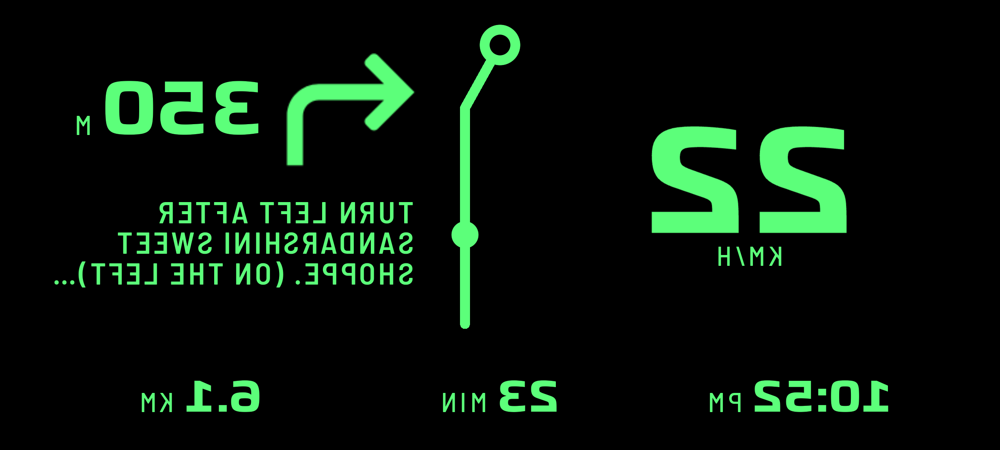 | 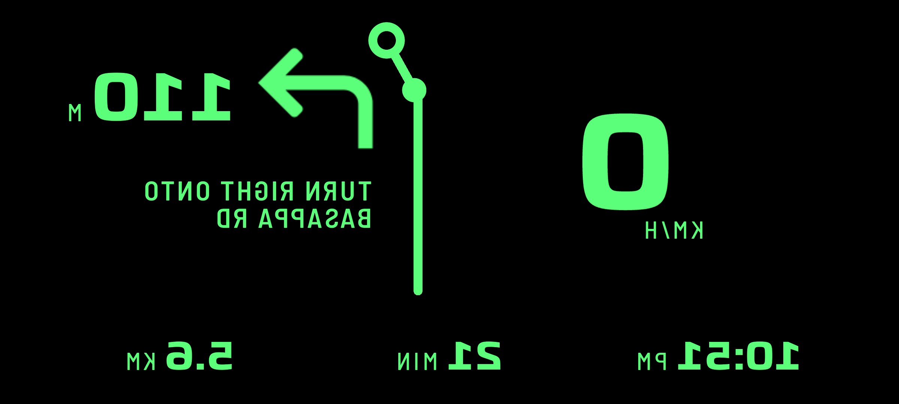 |

These are the real app, mirrored, through its real listener, parser and HUD. The two on the right are Google's own notification: its instruction, arrow, distance, ETA and distance left, read live while the emulator's position was stepped along a route in Bangalore (so Maps also reroutes now and then, and says so). The speed beside it comes from the simulated car, which is not in step with the emulator's position.

## Two things seen that the app cannot fix

| Maps' own floating window, over the HUD | Android 16 shows Maps' notification as a card |
|---|---|
| 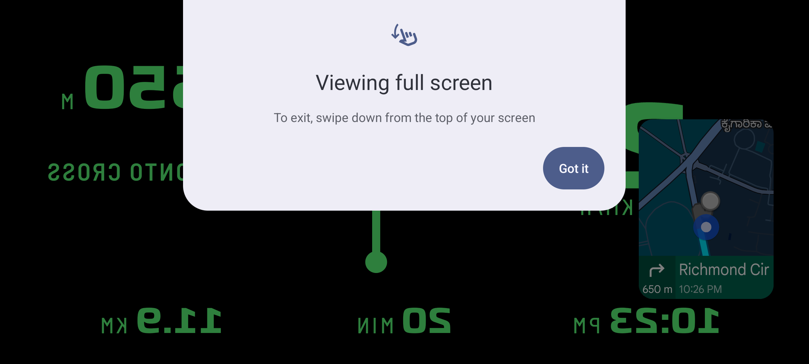 | 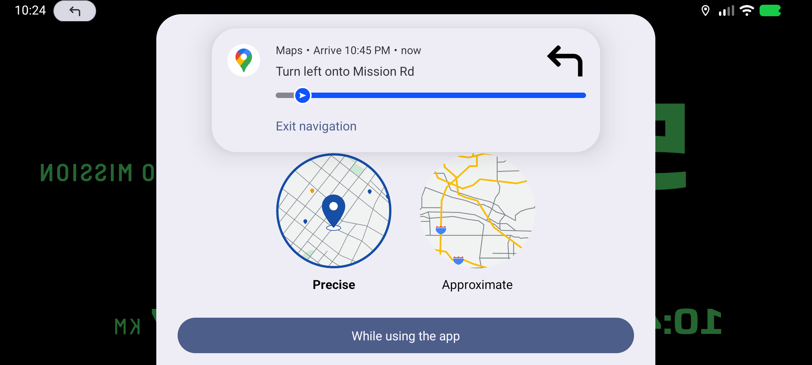 |

1. **Google Maps shrinks to a small floating map when you switch away from it during a route.** On the glass that would be a bright window on the HUD's black. Android lets you turn it off for Maps (Settings, Apps, Special app access, Picture-in-picture); Garage says so under Navigation, and the hardware handoff says to do it first.
2. **Android 16 shows a navigation notification as a card at the top**, the first time, and any app's heads-up notifications can come over the HUD in the same way. Do Not Disturb is the answer for the road; TapeDash does not turn it on.

(The location question in the second picture is TapeDash's own, asked on a first launch because the test script had not granted it; it is not part of this feature.)

## What I am asking you

1. **The instruction.** It is Google's own text in the phone's language, up to three lines at 0.068H (24 lp at 360). That is more than DESIGN.md 11's six words for a Motion screen, and I made it the one exception on purpose, because the street you turn onto is what a driver wants. **Is it readable at a glance on the glass, or should it be shorter** (two lines, or only what follows "onto")?
2. **The line with the dot.** Is it useful beside the arrow, or clutter on the glass? It is the thing you called "line maps"; it is cheap to take out.
3. **Three figures along the bottom** (ETA, time left, distance left). Keep all three? The time left is Google's when it gives one, and otherwise the ETA less the phone's clock.
4. **The takeover.** The layout comes and goes by itself with Maps' notification. There is no "navigation HUD" to choose. Is that right, or should the HUD stay as you left it unless you pick this one? (Side note: I could not find a Garage control for choosing among the three older HUD layouts; the choice is only kept in the settings. Say if that is wrong.)
5. **The wording:** NO UPDATE for a Maps that has gone quiet.
6. **The arrow's size** (0.34H) against the speed (0.34H): equal weight is deliberate.

## What is not reviewable yet, said plainly

- The windshield. Brightness, the double image of a laminated screen, and whether three lines of text survive it.
- Any real phone: the Notification access flow, the Android 13 "restricted settings" block on a sideloaded app, and how Android keeps Maps and TapeDash alive together.
- **Maps' notification on your own phone's Android**, in your language and units: only one capture, English and kilometres on Android 16, has been read. The steps to capture yours are in `docs/HARDWARE_HANDOFF.md` 5e.
- Maneuvers that have not been seen: a roundabout, a U-turn, a highway exit. Where the arrow cannot be read the line is drawn straight, and Google's own arrow still says it.
- Frame rate on an old phone. On the emulators, with software drawing, the HUD cost p50 1.3 ms and p99 5 to 7 ms (Android 16), p50 11 ms and p99 21 to 29 ms (Android 7). That says nothing about a real low-end phone.
