# Design review: the watch (DESIGN.md 16)

Written 2026-10-24. The human ran the app on a Samsung Galaxy Watch4 Classic the day before and the phone's screens did not fit; this is the watch's own surface, and the file format that moves its data. **The screenshots are from a Wear OS 3 (API 30) emulator with a 454 px round panel**, which is the Watch4 Classic's generation and size, driven by the simulated car (`tool/sim_server.dart`) over the production WiFi path. **Nothing here has met a real watch**: the wrist test of DESIGN.md 16.10 is not done, and the bezel has only been exercised through a mocked channel.

The pictures are cut to the circle (the emulator's own mask), so the corners are exactly what a watch shows.

## Before

| The first button, on the emulator | The Drive screen at 225 lp (a headless render) |
|---|---|
| 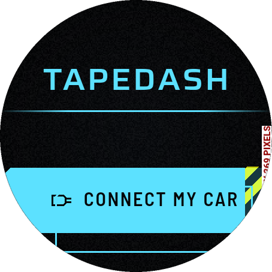 | 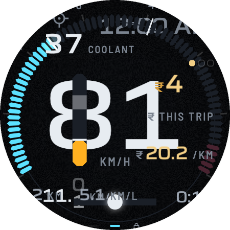 |

The phone's screens made small: "OVERFLOWED BY 269 PIXELS" on the first screen, the second button off the panel, and on the Drive screen the speed, the tach labels, the money and the trip figures on top of each other, with the clock and the first and last tach numbers in the corners the circle does not have.

## The first run

| Choice | Adapter type | Adapters found |
|---|---|---|
| 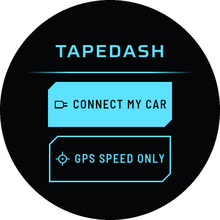 | 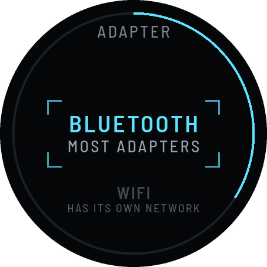 | 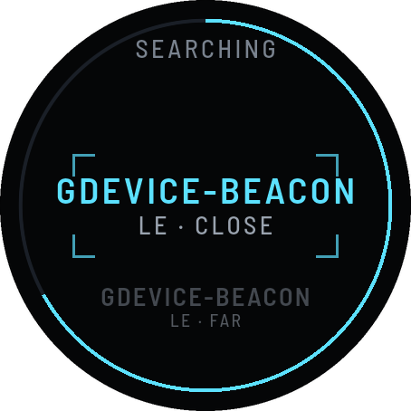 |

Two buttons inside the circle (48 lp, a touch target), then the connect flow as wheels: the type, then what the radios found, nearest first (this is the emulator's real BLE scan, which finds two beacons). A short arc of the rim shows how far through it is. Nothing asks for the car's fuel or the price on a wrist.

| GPS only (parked, no speed yet) |
|---|
| 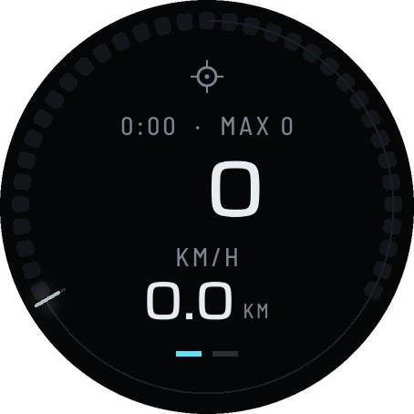 |

The speed, with a speed arc round the rim, the distance, the GPS glyph alone in the crown, and the trip's time and fastest over the speed while parked. (The emulator's GPS gives no speed, so a lit arc is not in the pictures.)

## Driving (Motion)

| 19 km/h | 50 km/h |
|---|---|
| 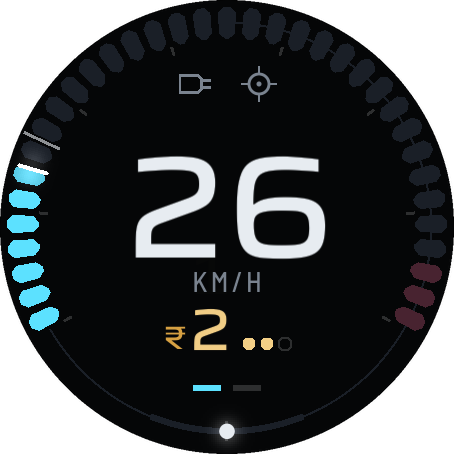 | 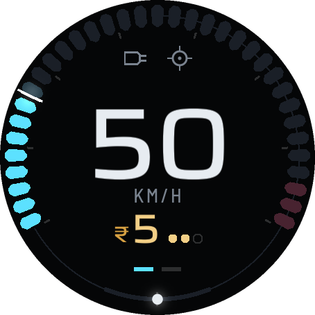 |

The revs round the rim (the tach arc, one segment per 200 rpm, the needle, the redline), the speed in the core, the ₹ of the trip in the foot, the eco bar bent into the gap at the bottom. Three values and a cue. Two page ticks: Motion reaches Drive and Money only.

## Parked

| Drive | Money | Where it went | Menu |
|---|---|---|---|
| 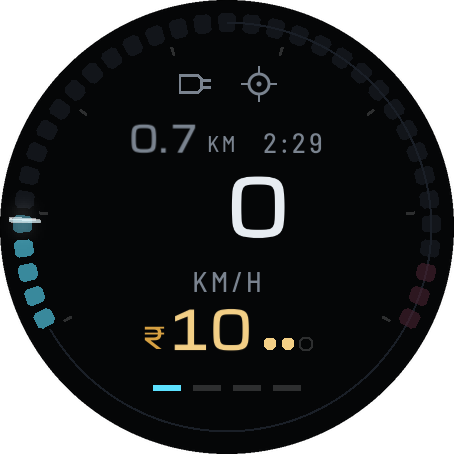 | 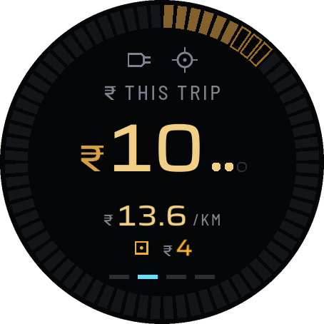 | 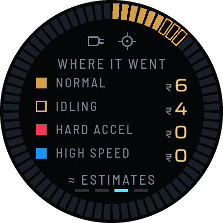 | 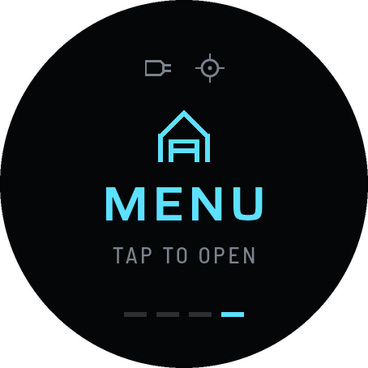 |

The ring dims and thins, the speed shrinks, the trip's distance and time come up; four page ticks. The Money face is the Money Tape wrapped round the rim (every ₹ a cell from 12 o'clock; the first cells here are hollow, the idling at the start). WHERE IT WENT is the four buckets, idling hollow, with the ring as the whole trip's barcode.

## The wheel (menu, choice, dial)

| Menu | Look | Menu, after choosing EMBER | Data | After an export |
|---|---|---|---|---|
| 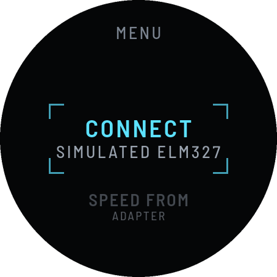 | 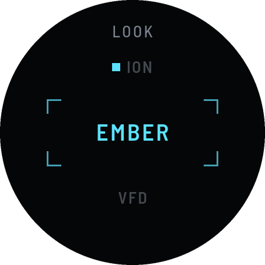 | 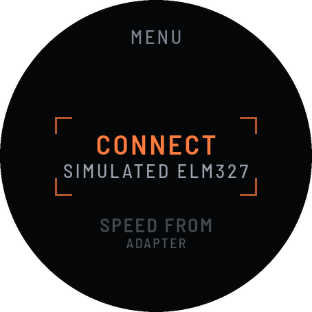 | 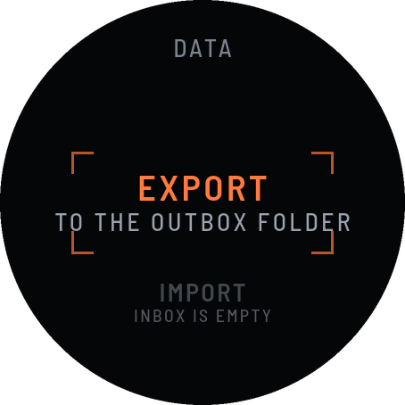 | 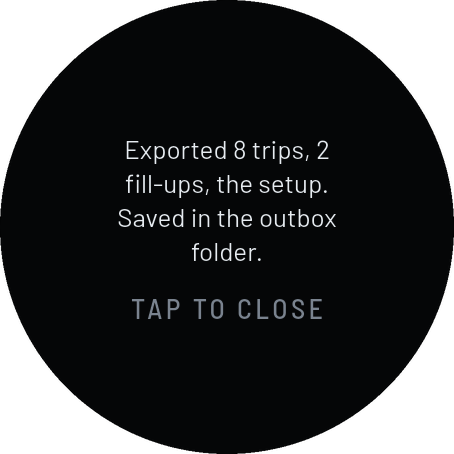 |

One component for the list, the choice (the lit cell) and the dial (the price steps ₹0.10 a detent). The chosen row sits between brackets; the title is high in the circle so that the row above never touches it. The last picture is the watch's own export, written to the outbox folder.

## Liveries (WHERE IT WENT)

| ION | EMBER | VFD | MONO |
|---|---|---|---|
| 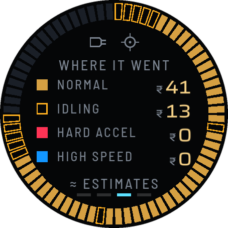 | 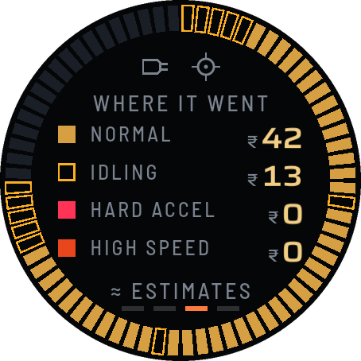 | 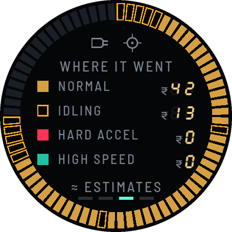 | 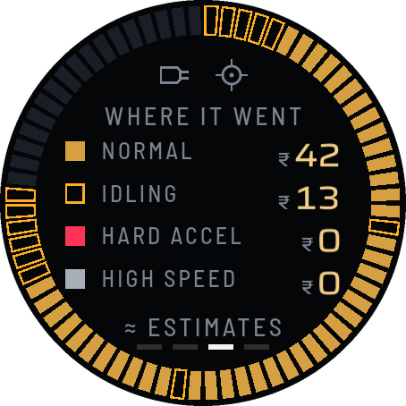 |

The same four liveries; VFD's seven-segment figures hold up at this size; MONO's numerals are lifted to weight 500 on a watch.

## The data path, as it ran on the emulator

```
tool/adb_exchange.sh push demo.tdx.gz        # staged in /data/local/tmp, copied by the shell user
tool/adb_exchange.sh import --apply          # "Added 8 trips and 2 fill-ups. The setup in the file was applied."
tool/adb_exchange.sh export profile,trips    # asked by intent, pulled, then:
dart run tool/tdx.dart check from-watch/*    # ok (19 lines)
dart run tool/tdx.dart csv   from-watch/*    # one row a trip
```

## Signature moments, for the watch

Finished and shown above: the tach arc as the rim (moment 2), the money ring (5, the Money Tape wrapped round), Stop and the face opens (6), VFD livery (10). **Not built:** the ignition sequence on the watch face (the phone's wave and sweep run on the shared signals and were not looked at on the watch), the Debrief (only "Where it went" is shown when a trip ends), the road view, the shift horizon (the rim's redline stands in).

## Deviations from DESIGN.md, and why (all in docs/DECISIONS.md)

- A tap anywhere turns the reel in Motion, which §11 does not list (page swipe, cluster swipe, HUD double-tap): on a watch the tap and the bezel *are* the page swipe, and there is no HUD.
- Landscape-only (CLAUDE.md 3) is the phone's rule: a watch keeps its own orientation.
- No vignette or grain on the watch (§4.1, 4.10), for OLED power and exact black corners.
- Numerals are never lighter than weight 500 on the watch (§4.4's MONO is 300).
- The menu cover opens the wheel on a tap, because a wheel inside the reel would take the swipe and the bezel from it.

## Open questions for the human

1. **Is the speed hero too large against the ring?** At three digits (100+) it fills the core's chord; it was checked by a pixel test and not by an eye on a wrist.
2. **Tap anywhere to turn the face** is the easiest thing in a car and the least harmful, but a wrist knocked on the wheel will flip Drive and Money. Would you rather the tap did nothing and only the bezel and the swipe turned it?
3. **Which way is clockwise?** Only the direction is sent from the bezel; if the Watch4 reads the other way round, one sign flips in `DeviceChannel.kt`.
4. **How long may the watch keep the screen on?** The dim after 60 s parked is specified and not built; it depends on what Wear OS does to an app that holds the screen awake for a whole drive.
5. **Should the watch ask for the price on the first run?** It does not (it is a dial in the menu, or arrives by import). A fuel price is the one number that makes the ₹ meaningful.

## What could not be captured

- A real watch, the bezel, sunlight, a moving wrist: none.
- `perf.md` (frame timings per tier): not made. An emulator's frame times say nothing about a watch's chip; the tier detector and the governor run on the watch (it starts at Lite and is held to Balanced) and have only been tested with fake timings.
- A screen recording (`adb shell screenrecord`) was not made.
